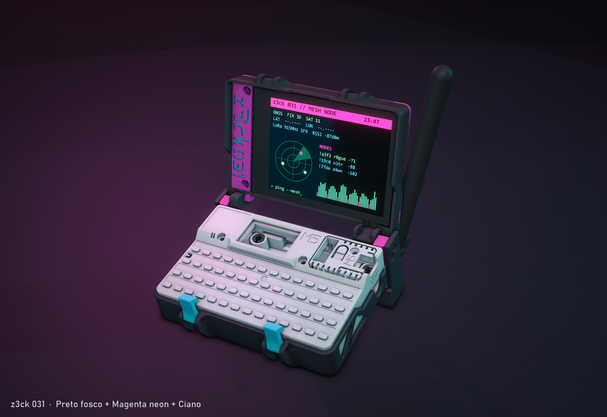
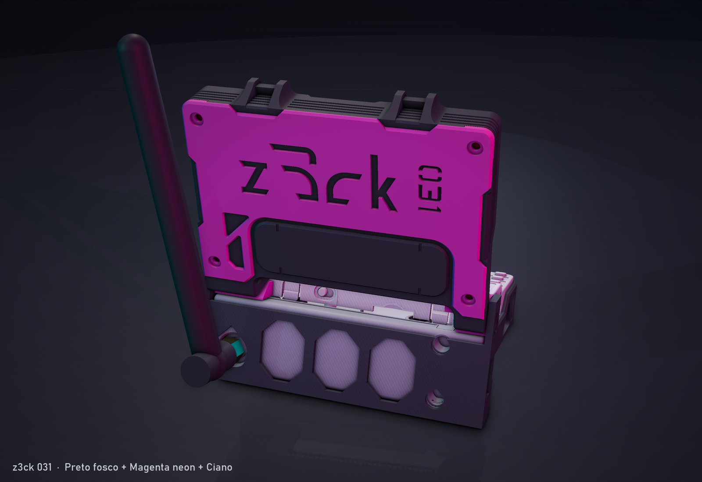

# cyberdeck-case: z3ck 031

Case impresso em 3D que transforma o **Cardputer-Adv** em um cyberdeck com **Cap LoRa-1262 (GNSS)** acoplado
e uma **TFT 2,8" ILI9341** na tampa. É uma adaptação do kit [TERM512](versao_AREA512/term512/README.md)
(estilo AREA512), com o logo trocado para **"z3ck 031"**.




## Estado

- Kit **TypeR** (TFT vermelha MSP2807 cortada para 81 × 51 mm, tampa fechada, capa do Cap vazada) **enviado para
  impressão** em 2026-11-12, sem medir os furos da placa. Montagem e firmware ainda não testados.
- 60 testes de regressão geométricos passando (encaixe contra os modelos oficiais da M5Stack, giro da tampa,
  folgas, parafusos, caminho dos fios, imprimibilidade).

## Pastas

| Pasta | Conteúdo |
|---|---|
| [`versao_z3ck031/`](versao_z3ck031/) | **Entregáveis.** Guia completo em [`LEIA_z3ck031.md`](versao_z3ck031/LEIA_z3ck031.md); STLs por tipo de tela (`STL_TypeA` azul, `STL_TypeB` preta, `STL_TypeR` vermelha cortada); pacote enviado à gráfica (`ENVIAR_GRAFICA_TypeR/` e `.zip`); peças na posição de montagem (`montagem/`); modelo 3D montado (`modelo_3d/*.glb`); renders. |
| [`ferramentas/`](ferramentas/) | Geradores em Python: `gerar_z3ck031.py` (kit base, capa, L1L/R1L, B1, C2 com logo), `gerar_tampa_vermelha.py` (TypeR), `render_foto.py` (renders), `exportar_montagem.py` (.glb). |
| [`testes/`](testes/) | Testes de regressão (pytest). |
| [`referencias_m5stack/`](referencias_m5stack/) | STLs oficiais do Cardputer-Adv, Cap LoRa-1262 e Mesh Kit ([M5Stack/M5_Hardware](https://github.com/m5stack/M5_Hardware)). |
| [`versao_AREA512/`](versao_AREA512/) | Projeto original TERM512 (referência). |
| [`versao_z3ck/`](versao_z3ck/) | Primeiro modelo próprio (rascunho, referência). |

## Regenerar e testar

```bash
python -m venv .venv && .venv/Scripts/pip install -r ferramentas/requirements.txt
python -I -X utf8 ferramentas/gerar_z3ck031.py         # kit base; cria .cache_z3ck031/ (~25 min na 1ª vez)
python -I -X utf8 ferramentas/gerar_tampa_vermelha.py  # TypeR (segundos)
python -I -X utf8 -m pytest testes -q                  # ~2,5 min
```

Se o `cadquery-ocp` der erro de hash ao instalar, baixe o wheel com `pip download` e instale o arquivo.

## Créditos

- Kit original **TERM512** e estética **AREA512**: ver [`versao_AREA512/term512/README.md`](versao_AREA512/term512/README.md)
  (créditos ao autor do TERM512 e a [engneer-hamachan](https://github.com/engneer-hamachan)).
- Modelos do Cardputer-Adv e do Cap LoRa-1262: [M5Stack](https://github.com/m5stack/M5_Hardware).
- O TERM512 e os modelos da M5Stack não trazem licença de redistribuição; por isso este repositório é privado.
