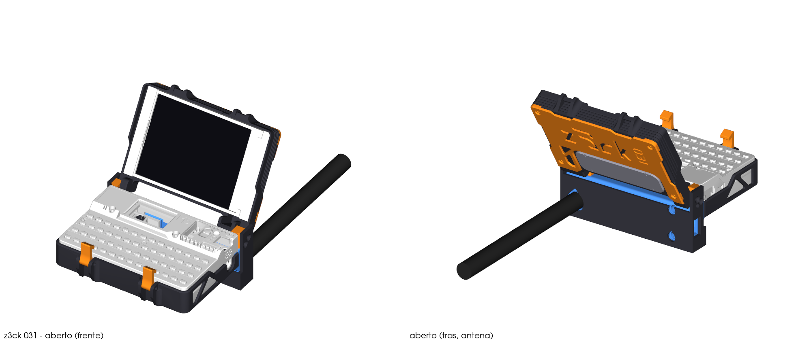
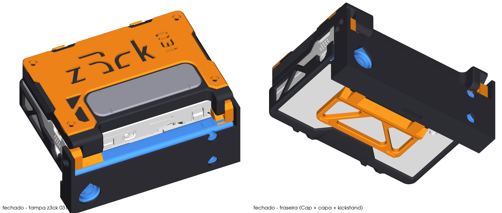
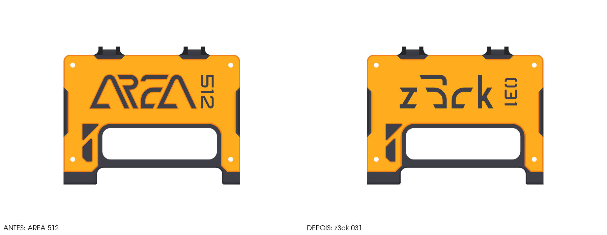
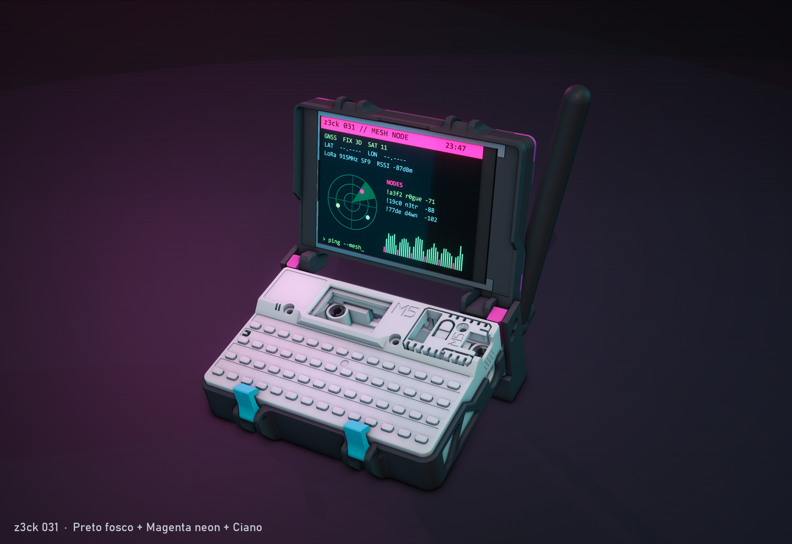
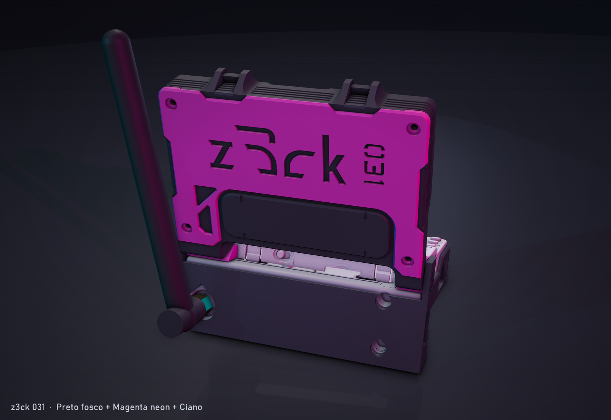
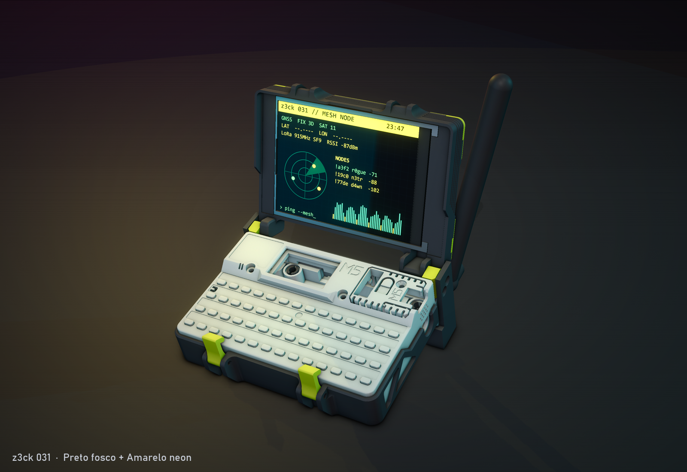
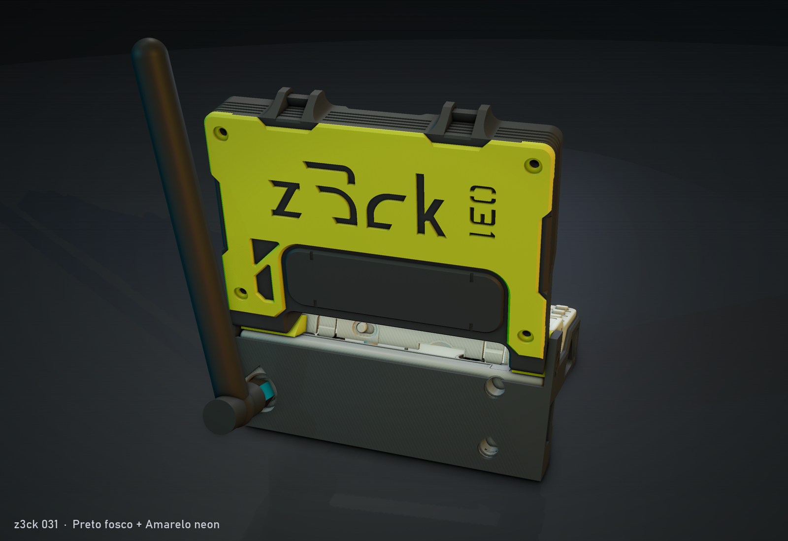
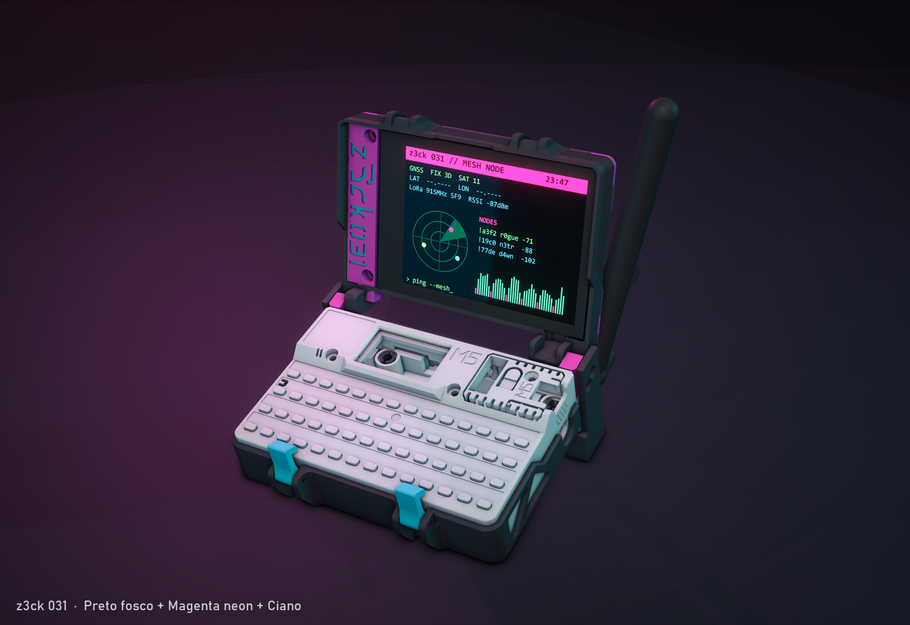
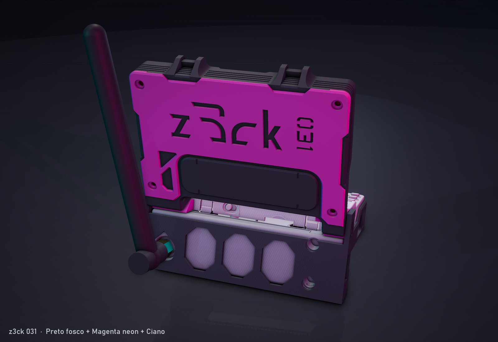

# z3ck 031: TERM512 adaptado para Cardputer-Adv + Cap LoRa-1262 (GNSS) + TFT 2.8" ILI9341

Adaptação do kit **TERM512 / AREA512** (pasta `versao_AREA512`) para funcionar **com o Cap LoRa-1262 + GNSS
encaixado no topo do Cardputer-Adv**, com a grafia trocada de **"AREA 512" para "z3ck 031"**.

Renders realistas com paletas cyberpunk (`ferramentas/render_foto.py`):

Versão **TypeR** (TFT vermelha cortada, tampa fechada com a C2 "z3ck 031"), seção 2.1:

**Modelo 3D montado (TypeR, cores da paleta magenta):** `modelo_3d/z3ck031_TypeR_aberto.glb` e `modelo_3d/z3ck031_TypeR_fechado.glb` (abre no Visualizador 3D do Windows ou no Blender; regenerar com `ferramentas/exportar_montagem.py`).

---

## 1. O problema que esta versão resolve

O TERM512 original **não funciona junto com o Cap LoRa-1262**, por dois motivos medidos nos modelos oficiais
da M5Stack (`referencias_m5stack/`):

| Conflito | Detalhe |
|---|---|
| **Mecânico** | A barra **S1** do TERM512 é ela própria um "cap": ocupa o mesmo volume e o **mesmo conector EXT 2x7** que o Cap LoRa. S1, C1, L1, R1 e B1 colidem com o Cap (1928 / 509 / 207 / 302 / 376 mm³). |
| **Elétrico** | A TFT do TERM512 usa G3 (RES), G5 (CS) e G6 (DC), que são **LoRa_RST, LoRa_NSS e LoRa_BUSY** no Cap. O Cap não tem pass-through. |

**O que NÃO precisou mudar:** a varredura completa da tampa (0° a 135°) **não toca o Cap em nenhum ângulo**.
Por isso tampa, display, dobradiça e eixo (Y=16,88 / Z=−5,07) ficam idênticos ao original.

## 2. Peças (pastas `STL_TypeA` = TFT de PCB azul, `STL_TypeB` = TFT de PCB preta)

| Peça | Status | Cor sugerida | O que é |
|---|---|---|---|
| `CaseS1L_capa_cap.stl` | **NOVA** | preto | Capa em "C" que desliza sobre o Cap: placa no topo, paredes laterais, parede traseira e gancho sob o ressalto do Cap. Substitui **S1 + C1 + header 2x7**. Tem furo para a antena RP-SMA, acesso aos 2 parafusos do Cap, janela do conector HY2.0 do Cap, janela da fenda traseira e saída de fios. **Vazada:** 3 janelas octogonais na placa do lado da antena e 4 na placa de baixo deixam o Cap cinza à mostra (−20% de material). Paredes laterais, gancho e furos ficam inteiros. Para voltar à capa cheia: `CAPA_VAZADA = False` em `gerar_z3ck031.py`. |
| `CaseL1L.stl` / `CaseR1L.stl` | **MODIFICADAS** | laranja | L1/R1 originais cortados acima do Cap (Y ≥ 8,96), com o mesmo furo de pivô e batente de 135°. Cada um tem 2 furos-guia Ø1,7 para M2. O L1L tem canal de fios 1,8×3,0 mm. |
| `CaseB1_z3ck.stl` | **MODIFICADA** | preto | Base original sem a faixa superior (Z < 2,3 mm), que ficava onde agora está o Cap. Pinos LEGO, laterais e travas preservados. |
| `CaseC2_z3ck031.stl` | **MODIFICADA** | laranja | Placa da tampa com **"z3ck 031"**: letras vazadas na chapa de 1 mm, como o original (a D1 preta aparece por trás). O "0" tem pontes de estêncil para o miolo não cair. |
| `CaseD1, D2, D3, C3, T1, K1, K2` | originais (cópia byte-a-byte) | como no TERM512 | Imprimir **2× T1**. |
| ~~S1, C1~~ | **removidas** | | O Cap LoRa ocupa o lugar delas. |

### Orientação de impressão (igual ao 3MF original, testado em PLA 0,12 mm / 2 paredes / 15%)

| Peça | Como deitar na mesa |
|---|---|
| CaseS1L | Já exportada na orientação: **parede traseira na mesa** (balanço > 45° em só 0,4% da superfície, sem suporte). Use **4 perímetros** (paredes de 1,6–2,0 mm = sólidas). PETG recomendado. |
| CaseL1L / CaseR1L | Já exportadas: **face externa na mesa** (furo do pivô fica vertical e redondo). |
| CaseB1_z3ck | Mesmo referencial do STL original: **traseira na mesa** (eixo +Y do arquivo para cima). |
| CaseC2_z3ck031 | Mesmo referencial do STL original: **face com o logo na mesa** (eixo −Y do arquivo para cima, textura da mesa no logo). |

### Material

| Peças | Material | Por quê |
|---|---|---|
| CaseS1L, CaseL1L, CaseR1L, CaseB1_z3ck, CaseT1 (×2), CaseK1, CaseK2 | **PETG** | Peças que deslizam, travam ou levam parafuso. PETG flexiona um pouco antes de quebrar; PLA é mais rígido e trinca em clipes e travas. PETG também aguenta ~75 °C (PLA amolece a ~55 °C, ex.: carro ao sol). |
| CaseC2_z3ck031, CaseD1, CaseD2, CaseD3, CaseC3 | PETG ou PLA | Tampa e placa do logo: pouco esforço. PLA dá cantos mais nítidos nas letras e tem mais cores. |

- Se a gráfica só tiver PLA, peça **PLA+ / PLA Tough** para as peças funcionais.
- Evite filamento **silk** nas peças funcionais (adesão entre camadas menor).
- ASA só para uso frequente ao sol (resiste a UV); encolhe mais e pode apertar as folgas de 0,3 mm.

## 2.1 TypeR: TFT vermelha cortada (81 × 51 mm), tampa fechada com a C2 "z3ck 031" (`STL_TypeR`)

Para a placa vermelha **"2.8\" TFT SPI 240x320 V1.2"** (LCDwiki MSP2807, 14 pinos, touch + SD) cortada do
lado do SD para **81 × 51 mm**. A tampa tem **exatamente a mesma espessura e o mesmo visual do TypeA**. A placa
traseira C2 com o logo é a mesma peça.

**Arquivos prontos para a gráfica:** `ENVIAR_GRAFICA_TypeR/` (12 STL já deitados para impressão, com a cor no
nome, e `PEDIDO_LEIA.txt`) ou `z3ck031_TypeR_impressao.zip`.

| Peça | Status | O que é |
|---|---|---|
| `CaseD1R` | **MODIFICADA** (da D1) | Rebaixo da tela refeito para a pilha de 5,6 mm da placa vermelha (os apoios recuam até o verso da PCB). Alívios rasos no fundo para os componentes do verso. 2 furos-guia cegos Ø1,7 para M2×4. Passagem dos fios para a fenda da dobradiça esquerda. Fora disso é idêntica à D1. |
| `CaseC3R` | **MODIFICADA** (da C3) | Mesma janela traseira, com alívio para o chip do touch (U2) que fica atrás dela. Colar como a C3 original. |
| `CaseD2R_z3ck031` | **NOVA** (substitui D2) | Moldura do lado dos pinos: 2 furos com rebaixo para a cabeça do M2×4 e canal para os fios soldados na frente da placa. Leva "z3ck 031" gravado (0,6 mm); logo bicolor com troca de filamento a 0,6 mm. |
| `CaseC2_z3ck031` + base (S1L, L1L, R1L, B1, T1 ×2, K1, K2) | iguais ao TypeA | Cópias exatas. |
| ~~D2, D3~~, módulo AMS1117, **slot SD da placa** | **removidos** | A placa vermelha tem regulador de 3,3 V. O slot SD (2–3 mm de altura) não cabe com o fundo fechado: tire-o com soprador ou alicate de corte rente. |

**Montagem da tela**
1. Tire o slot SD e a barra de 14 pinos. Solde os fios **pela frente** da placa, nos furos dos pinos, e apare
   as pontas no verso, rente.
2. Coloque a placa na D1R pela frente: pinos à esquerda (visto de frente), lado cortado à direita.
3. Passe os fios pelo canal da D2R, pelo canto livre embaixo à esquerda e pela fenda da dobradiça esquerda,
   seguindo para o canal do L1L como no TypeA.
4. Ponha a D2R e aperte **2 parafusos M2×4 de cabeça cilíndrica** pela frente. Eles passam pela D2R e pelos
   2 furos da placa e rosqueiam na D1R. O lado cortado só apoia atrás.
5. Cole a C3R e encaixe a C2 como no original.

**Antes de imprimir, confira com paquímetro.** O eixo dos parafusos tolera ±0,55 mm:

| Medida | Valor usado | Origem |
|---|---|---|
| Borda dos pinos → centro dos 2 furos | 7,5 mm | foto da sua placa (desenho oficial da placa de 86 mm: 6,92) |
| Distância entre os 2 furos | 44,9 mm | foto (desenho: 44,0) |
| Frente do vidro → verso da PCB | 5,6 mm | desenho MSP2807 |
| Componente mais alto no verso (sem o slot SD) | ≤ 1,2 mm | TSSOP/SOT-23 |

Se alguma medida for diferente, ajuste `FUROS_PCB`/`FURO_X`/`ESP_PAINEL`/`COMP` em
`ferramentas/gerar_tampa_vermelha.py` e rode de novo o gerador e os testes (segundos). A variante sem fundo
continua disponível com `--aberta`.

**Fiação (TFT vermelha):** use só VCC, GND, CS, RESET, DC, SDI(MOSI), SCK e LED. SDO(MISO) e T_* ficam livres.

| Pino da TFT vermelha | Liga em |
|---|---|
| VCC | Grove 5 V (o regulador da placa gera 3,3 V; J1 aberto) |
| GND | Grove GND |
| CS / DC | G1 / G2 (Grove), como no TypeA |
| SDI(MOSI) / SCK | LoRa_MOSI / LoRa_SCK do Cap (mesmo SPI), como no TypeA |
| RESET | 3,3 V da própria placa (saída do regulador U1; meça antes) via 10 kΩ, + 100 nF ao GND |
| LED | VCC (liga o backlight pelo transistor Q1 da placa) |

**Limitações do TypeR:** a tela é modelada como envelope (painel + PCB + componentes estimados da foto, com
~2 mm de margem nos alívios). A rosca na D1R é curta (1,16 mm): aperte sem forçar. Os 24 testes de
`testes/test_tampa_vermelha.py` cobrem: mesma espessura do TypeA, C2 idêntica e sem conflito, encaixe da tela,
folga dos componentes, parafusos, caminho dos fios, giro da tampa 0–135°, batente e logo.

## 3. Ferragens (BOM)

| Item | Qtd | Uso | Mudança vs. TERM512 |
|---|---|---|---|
| M2×6 cabeça chata (escareada) | 4 | D2/D3 → D1 | igual |
| **M2×6 cabeça chata (escareada)** | **4** | **L1L/R1L → paredes laterais da capa** | **novo** |
| M2×10 cabeça cilíndrica | 4 | T1 ↔ B1, K1 ↔ K2 | igual |
| M2×5 cabeça cilíndrica | 0 | (eram S1/C1 e L1/R1 → S1) | **removido** |
| Header 2,54 mm 2×7 | 0 | (era S1 no EXT) | **removido** |
| Módulo AMS1117-3.3 | 1 | 5 V → 3,3 V da TFT | igual |
| Cabo HY2.0-4P (Grove) com uma ponta cortada | 1 | CS/DC/5V/GND da TFT no Port do Cardputer | **novo** |
| Fio fino (Ø externo ~0,65 mm) | ~6 | lid → base | igual |
| Resistor 10 kΩ (opcional, + 100 nF) | 1 | RES da TFT em pull-up | **novo** |

## 4. Fiação (pinos remapeados por causa do Cap)

O Cap usa G3, G4, G5, G6, G8, G9, G13, G14, G15, G39 e G40. Sobram **G1 e G2**, no Port do Cardputer-Adv
(PORT.CUSTOM: GND, 5V, G2, G1). O SPI (G40/G14) é **compartilhado** entre TFT, SX1262 e microSD, cada um com seu CS.

| TFT (8 pinos) | Liga em | Observação |
|---|---|---|
| GND | Grove GND (preto) | |
| VCC | AMS1117 VOUT (3,3 V) | AMS1117 VIN ← Grove 5V (vermelho) |
| SCL (SCK) | **G40**, derivação no pino LoRa_SCK do Cap | solda no header do Cap (ver abaixo) |
| SDA (MOSI) | **G14**, derivação no pino LoRa_MOSI do Cap | solda no header do Cap |
| RES | 3,3 V via 10 kΩ (+100 nF ao GND) | reset por software (cmd 0x01) |
| DC | **G2** (Grove) | era G6 (agora LoRa_BUSY) |
| CS | **G1** (Grove) | era G5 (agora LoRa_NSS) |
| BLK | 3,3 V (AMS1117 VOUT) | só a TFT de PCB azul tem BLK |

**Derivação de SCK/MOSI:** abra o Cap pelos 2 parafusos do topo (ficam acessíveis pelos furos da capa) e solde
dois fios finos nos pinos **LoRa_SCK (Cap-Bus 11)** e **LoRa_MOSI (Cap-Bus 12)**. Os fios saem pelo topo do Cap
(furo de ~2 mm feito por você, ou pela fresta de ~0,8 mm junto ao header, em X 33–51) direto no espaço livre
acima do Cap, que é o mesmo caminho dos fios da TFT no TERM512.

**Caminho dos fios:** TFT → dobradiça (como no original) → espaço sobre o Cap → canal no fundo do L1L →
furo Ø3 na parede esquerda da capa → por fora até o Port (Grove) na lateral esquerda do Cardputer.

> ⚠️ **Confira com multímetro antes de ligar:** (a) a ordem de cores do cabo Grove (a documentação da M5Stack
> é ambígua sobre amarelo=G2/branco=G1; se inverter, só troque CS/DC no firmware); (b) se há 5 V no Port do
> Cardputer-Adv com o aparelho ligado. Se não houver, use o **5V_OUT do Cap-Bus (pino 5)**.

**Firmware:** TFT, SX1262 e SD precisam usar **o mesmo host SPI** (no ESP32-S3, dois hosts não podem disputar
os mesmos pinos). Ponto de partida (LovyanGFX): `spi_host = SPI2_HOST`, `pin_sclk = 40`, `pin_mosi = 14`,
`pin_miso = -1`, `pin_dc = 2`, `pin_cs = 1`, `pin_rst = -1`, `bus_shared = true`, `freq_write = 27 MHz`
(fios longos e finos). Coloque **todos os CS em nível alto (G1, G5, G12)** antes de iniciar qualquer driver.
Lembre que o LoRa do Cap exige **P0 do PI4IOE5V6408 em nível alto** (chave de antena).
*A parte de firmware não foi testada em hardware.*

## 5. Ordem de montagem

1. Cap LoRa-1262 no Cardputer-Adv com os parafusos M2×4 dele. **Remova a antena.**
2. Solde as derivações SCK/MOSI no Cap (seção 4) e feche o Cap.
3. **Deslize a CaseS1L por trás** (em direção ao teclado): a placa passa sobre o topo do Cap, o gancho entra
   sob o ressalto e a parede traseira encosta no Cap. Não precisa forçar: o curso foi verificado sem colisão.
4. Monte a tampa como no TERM512: C2/C3 em D1 (C3 com cola), display, D2/D3 com 4× M2×6.
5. Encaixe **L1L e R1L nos pinos da D1**, apoie os dois sobre o Cap entre as paredes laterais da capa, passe
   os fios pelo canal do L1L e fixe com **4× M2×6 escareados** pelas paredes laterais. Com isso a capa fica
   travada nas 6 direções (jogo medido de 0,18 a 0,34 mm).
6. B1 + 2× T1 (M2×10) e K1 + K2 (M2×10), como no original.
7. Rosqueie a antena pelo furo da capa. **Não ligue o LoRa sem antena.**

## 6. Testes de regressão (35 testes, todos passando)

Rodar: `python -I -X utf8 -m pytest testes -v` (depois de `python -I -X utf8 ferramentas/gerar_z3ck031.py`).

| Grupo | O que verifica |
|---|---|
| Integridade | Todos os 12 STL de cada tipo fechados, manifold, 1 corpo. As 7 peças reaproveitadas são cópias byte-a-byte. S1/C1 ausentes. |
| Controle negativo | As peças **originais** colidem com o Cap (prova que o teste detecta o problema). |
| Encaixe estático | Peças novas não invadem o Cap (folga ≥ 0,2 mm) e não invadem o Cardputer mais que as originais. Peças não se cruzam entre si. |
| Tampa | Eixo do pivô idêntico. Varredura **0°→135° sem colisão** com Cap, capa, B1, L1L/R1L e Cardputer. Batente em ~136° preservado. |
| Montagem | A capa entra deslizando sem cruzar Cap, Cardputer ou kickstand em todo o curso. Nada da capa dentro do corpo do Cap. Conjunto travado nas 6 direções. |
| Acessos | Antena RP-SMA (Ø ≥ 11), parafusos do Cap, conector HY2.0 do Cap, saída de fios. |
| Placa C2 | Fora do logo, idêntica à original. Texto novo exato, sem resto do AREA 512. **Nenhuma ilha solta.** Traços e pontes ≥ 0,8 mm (bico 0,4). Mesma posição na D1. |
| Imprimibilidade | Paredes da capa ≥ 1,2 mm. |

## 7. Limitações (leia antes de imprimir)

- **Nada foi impresso nem montado fisicamente.** As verificações usam os STL oficiais da M5Stack (Cardputer-Adv,
  Cap LoRa-1262, Mesh Kit) e o STEP do TERM512, com zonas de exclusão voxelizadas a 0,15 mm.
- O modelo do Cardputer-Adv da M5Stack **não tem a abertura do Port (Grove)**. A posição exata do conector na
  lateral não foi verificada; a saída de fios da capa fica na parede esquerda.
- A B1 agora é um **"U" aberto em cima** (a faixa superior ficava onde está o Cap). A retenção dela no Cardputer
  (pinos LEGO, laterais, borda inferior) foi preservada (275 de 286 mm³ de contato), mas as laterais ficam um
  pouco mais flexíveis.
- A capa fica 0,8 mm mais larga que a B1 de cada lado (88,6 × 87,0 mm), por causa das paredes que recebem os M2.
- Firmware/elétrica (SPI compartilhado, 5 V no Port) é recomendação a validar.

## 8. Como regenerar / alterar

- `ferramentas/gerar_z3ck031.py`: parâmetros no topo (folga, espessuras, posição dos furos, etc.).
- `ferramentas/logo_z3ck.py`: glifos do "z3ck" e do "031" (mesmo estilo do AREA: traço 2,0 mm, diagonais de 59,6°).
- O cache de voxels fica em `.cache_z3ck031/` (~400 MB). Pode apagar; ele é refeito em ~25 min.
- `montagem/TypeA|B/`: todas as peças **na posição montada** (referencial do STEP do TERM512), para visualizar.
- Dependências: `ferramentas/requirements.txt`.

Créditos: kit TERM512 (baseado no CapTFT V2 de Prokuon, inspirado no firmware AREA512 de engneer-hamachan);
modelos 3D oficiais M5Stack (repositório M5_Hardware).
